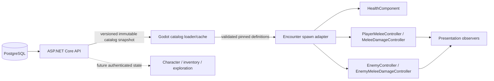

# Milestone 09A.1 — RPG data architecture proposal

**Historical 09A.1 design baseline.** At 09A.1 no database, backend, migration or gameplay change had been made. The later [local setup](POSTGRESQL_LOCAL_SETUP.md) created an empty development database and restricted role. The [09A.2 final review](MILESTONE_09A_2_FINAL_REVIEW.md) governs proposed schema corrections; no RPG schema has been executed.

## Repository findings and compatibility baseline

The inspected branch is `feature/milestone-05-animation`. The working tree contains substantial pre-existing modified and untracked 06D, combat, adventure and Milestone 08 work; this design does not alter it. `Ashenfall.csproj` uses `Godot.NET.Sdk/4.7.2` and .NET 8 for Windows. There is no PostgreSQL provider, backend, catalog, account, inventory or progression implementation. Existing weapon and armor are procedural **visual geometry**, not item records. Godot `.tres` resources hold art/animation/environment assets, not RPG master data.

| Current behavior | Verified source | Proposed seed/runtime mapping |
| --- | --- | --- |
| Dwarf 100 max HP | `AshenfallDwarfPlayableDemo.tscn` → `Health.MaximumHealth` | `character_classes.base_max_health=100`; `HealthComponent` remains the runtime owner of current HP |
| Dwarf fixed hit 25 | same scene → `MeleeDamage.Damage` | `character_classes.fixed_damage=25`; no random range or critical calculation |
| Dwarf attack 1.70 s; logical impact 0.94 s; melee range 1.45 m | `PlayerMeleeController.cs` defaults; `MeleeDamageController.cs` | `attack_cycle_ms=1700`, `impact_ms=940`, `melee_range_m=1.45`; adapter sets the existing `ImpactFraction=940/1700` |
| Dwarf movement 2.5 m/s | `DwarfPresentation.MovementSpeedOverride` in playable scene | `character_classes.move_speed_mps=2.5`; animation calibration stays visual-only |
| Guardian 100 HP, fixed hit 10, range 1.45 m | `FallenGuardian.tscn`, `EnemyController.cs`, `EnemyMeleeDamageController.cs` | `enemy_definitions.max_health=100`, `fixed_damage=10`, `attack_range_m=1.45` |
| Guardian base windup 0.60 s, recovery 1.00 s, impact 0.10 s after `AttackExecuted` | `EnemyController.cs`, `EnemyMeleeDamageController.cs` | `windup_ms=600`, `recovery_ms=1000`, `impact_after_execute_ms=100`; base impact is 0.70 s from attack entry |
| First adventure's three Guardians wind up for **1.20 s** | `AshenfallFirstAdventure.tscn` overrides all three | keep a **scene/spawn override** of 1200 ms; impact is 1.30 s from attack entry there. Do not change the shared Guardian definition to 1200 ms |
| Guardian chase 1.0, return 0.7 m/s; detection 6, disengage 10, max spawn distance 12 m | `EnemyController.cs` defaults | seed definition values; West/East adventure overrides detection 5.5, disengage 8, max spawn distance 8 m |

`PlayerMeleeController` owns one approach and one logical attack per command; `MeleeDamageController` consumes a sequence before validating impact. `EnemyController` owns AI and emits `AttackExecuted`; `EnemyMeleeDamageController` delays 0.10 s, consumes its sequence, checks range/line of sight/alive state, and applies damage. `HealthComponent` clamps and emits death once. The animation controllers observe these states. These are the migration seams: data is applied **at spawn/encounter creation**, never fetched during an attack. No catalog field should change these semantics. The current prototype is client authoritative; future multiplayer must revalidate the same commands and compute results on the host.

## Proposed boundary

The API is the **only** application component with DB credentials. PostgreSQL stores immutable published master catalogs and, later, mutable account/character state. A Godot loader validates one complete catalog snapshot, atomically swaps the current *available* snapshot, and pins a snapshot reference for each active encounter. Combat uses that in-memory data; the API is never on the attack/movement/frame path. A new catalog takes effect only on an explicit reload plus a new encounter/restart. Scene keys are resolved through a local allowlist, so catalog strings cannot load arbitrary `res://` paths.

## Deliberately small first implementation

09A.2–09A.5 require only four catalog tables: releases, classes, enemies, and item definitions. The 09A.2 seed proposal includes a visual training axe and Guardian sword, without active item statistics. Seven additional tables are proposed but **deferred**: accounts, player characters, class level rules, item modifiers, owned items, equipped items, and exploration chunks. No account/character API is exposed until authentication and ownership checks exist. An explicit development-only bundled snapshot or existing scene defaults keeps the local playable demo available during migration; an online production build must not silently treat fallback data as authenticated state.

EF Core with the Npgsql provider is recommended for the small relational model, reviewed migrations, and future character state. Use a short explicit PostgreSQL `SELECT ... FOR UPDATE` transaction for the one-character creation limit when that future endpoint is introduced. Dapper or raw Npgsql for all CRUD now would add manual mapping/migration work without a measured benefit. EF migrations should be reviewed and applied by an operator in a later milestone, not automatically at API startup. The `.sql` document in this folder is a proposal, not an executable migration.

## Risks and tradeoffs

- A catalog request can fail or return incompatible data: validate schema major, version/hash metadata consistency, IDs, ranges and cross references before publishing it to the client cache. The backend verifies the canonical content hash; client recomputation needs an agreed canonical format. Retain the last validated snapshot during a current encounter; show a clear startup/retry error for an online production session without a valid catalog.
- Client-side stats are currently editable by a modified client. This is acceptable only for the offline prototype. A future authoritative host must load the pinned catalog itself, validate commands/ownership and persist outcomes; a client-reported hit or stat is never authoritative.
- Catalog UUIDs and `code` values are distinct: UUIDs link persisted records, while stable codes identify definitions in DTOs and local scene mappings. Publishing is immutable, and references to old versions remain resolvable.
- Compact exploration masks reduce row count but require map revision, cell size and encoding compatibility. Current visibility stays transient; atmospheric fog remains separate.
- A single rich snapshot endpoint is simpler and atomically consistent for the current tiny catalog. If it grows, version-pinned paging or category endpoints can be added without changing the combat boundary.

See [data model](RPG_DATA_MODEL.md), [SQL proposal](POSTGRESQL_SCHEMA_PROPOSAL.sql), [API contract](API_CONTRACT_PROPOSAL.md), [Godot integration](GODOT_CATALOG_INTEGRATION.md), and [implementation plan](MILESTONE_09A_IMPLEMENTATION_PLAN.md).

## Sources consulted for design choices

PostgreSQL documents [exact `numeric` versus inexact floating-point types](https://www.postgresql.org/docs/current/datatype-numeric.html), [UUIDs](https://www.postgresql.org/docs/current/datatype-uuid.html), [JSONB](https://www.postgresql.org/docs/current/datatype-json.html), and [row locks](https://www.postgresql.org/docs/current/explicit-locking.html). Microsoft documents [EF Core migrations](https://learn.microsoft.com/en-us/ef/core/managing-schemas/migrations/), [optimistic concurrency](https://learn.microsoft.com/en-us/ef/core/modeling/concurrency), [API error responses](https://learn.microsoft.com/en-us/aspnet/core/fundamentals/error-handling?view=aspnetcore-8.0), and [ASP.NET Core output caching](https://learn.microsoft.com/en-us/aspnet/core/performance/caching/output?view=aspnetcore-8.0); [Npgsql documents its EF provider](https://www.npgsql.org/efcore/). These are design references, not newly installed dependencies.
