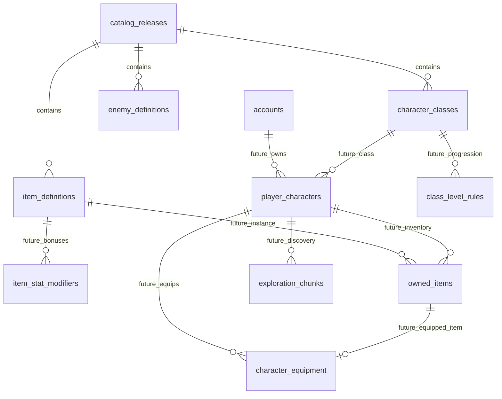

# Milestone 09A.2 — final RPG catalog design review

**DESIGN PROPOSAL — NOT APPROVED FOR EXECUTION.** No RPG table, migration, seed row, backend project or gameplay change has been made. This review refines [09A.1](MILESTONE_09A_1_ARCHITECTURE.md); the companion [SQL proposal](POSTGRESQL_SCHEMA_PROPOSAL.sql) is **not** an executable migration. Approval of this document is required before implementation.

## Verified baseline and database state

The project remains on `feature/milestone-05-animation` at `2735828`, with existing modified and untracked 06D/combat/adventure work preserved. `ashenfall_dev` runs PostgreSQL 18.7 and is owned by `postgres`; `ashenfall_app` can authenticate and CONNECT but has no database CREATE/TEMPORARY or `public` schema USAGE/CREATE, no role memberships, and none of SUPERUSER/CREATEDB/CREATEROLE/REPLICATION/BYPASSRLS. Read-only catalog inspection found **zero application tables**. No credential file was read.

| Runtime source | Value to preserve | Catalog or scene mapping |
| --- | --- | --- |
| Dwarf `HealthComponent` / `MeleeDamageController` | 100 maximum HP; one fixed 25 damage on a valid hit | `character_classes.base_max_health=100`, `fixed_damage=25` |
| Dwarf movement / melee | 2.5 m/s, 1.45 m range, 1700 ms cycle, 940 ms impact | class `move_speed_mps`, `melee_range_m`, `attack_cycle_ms`, `impact_ms` |
| Guardian health / melee | 100 maximum HP; one fixed 10 damage on a valid hit; 1.45 m attack range | enemy `max_health`, `fixed_damage`, `attack_range_m` |
| Guardian shared AI | 600 ms windup, 1000 ms recovery, 100 ms post-`AttackExecuted` impact delay; chase 1.0 m/s, return 0.7 m/s; detection 6 m, disengagement 10 m, spawn leash 12 m, stop 1.3 m, resume 1.7 m | corresponding `enemy_definitions` columns |
| First adventure | All three Guardians use 1200 ms windup; West/East detection 5.5 m, disengagement and spawn leash 8 m | **scene-specific overrides** remain, never overwritten by the shared seed |

The first adventure also configures encounter-zone activation/release radii, placements, objective radius and visuals. Other AI/navigation/camera parameters remain existing scene/controller configuration, outside this catalog cutover. The procedural dwarf axe and Guardian sword are visual meshes, not equipped item instances. Neither an inventory nor item-based damage calculation currently exists.

## Four initial tables and corrected relationships

Only `catalog_releases`, `character_classes`, `enemy_definitions` and `item_definitions` belong to the **first migration**. The seven other tables in the SQL file are design references for later, separately approved migrations. No persistent row is created for a temporary Guardian spawn. Definitions have UUID primary keys and `(catalog_release_id, code)` uniqueness; historical releases are retained while referenced.

### Exact schema changes from 09A.1 and reasons

| Table | Proposed correction | Reason |
| --- | --- | --- |
| `item_definitions` | Add nullable `hand_requirement smallint`, constrained to 1/2 for weapons and NULL for non-weapons; two-handed weapons require `equip_slot='main_hand'` | Represents the dwarf's two-handed axe without a new table or encoded slot list |
| `catalog_releases` | Allow NULL `content_sha256` while draft; require hash and `published_at` for published/retired, require NULL `published_at` for draft; add lifecycle guard | A draft can be assembled before its final hash exists; immutable published metadata and legal transitions become explicit |
| `character_classes`, `enemy_definitions` | Make inactive strength/dexterity/vitality/armor columns nullable without numeric defaults | The game has no verified values; NULL means not authored, rather than inventing gameplay statistics or implying zero is a balance decision |
| All four initial tables | Add a release guard trigger and three definition guard triggers | Database-level ordinary-DML protection against modifying published/retired content; parent row lock serializes draft writes with publication |

`hand_requirement=2` does **not** add an off-hand equipment row: the future equipment service must require the off-hand empty when equipping it and reject a later off-hand equip while it remains. The current `character_equipment` primary key protects one item per slot but cannot express this cross-row rule with a simple CHECK. The future authenticated equipment transaction will validate the owned item, category, slot and both hands together; a database trigger may be considered if multiple write paths are later allowed. No equipment behavior is implemented now.

The 25/10 fixed-damage columns are the entire current logical hit result. The proposed items are catalog identities/visual metadata only. No `weapon_damage` or `weapon_speed` field is added to the first schema: neither values nor a stacking/override formula exist in gameplay. In 09B, a separately versioned formula may introduce intrinsic `weapon_min_damage`/`weapon_max_damage` on weapon definitions, while `item_stat_modifiers` supplies generic additive/percentage bonuses, including attack-cycle and critical modifiers. One authoritative authored weapon range avoids simultaneous competing damage fields. The owner must approve whether a weapon replaces or augments the class baseline before any equipment bonus is enabled. Until then, equipping is unavailable and 25/10 never changes.

### Publication and immutability boundary

The proposed partial unique index permits **at most one** `published` release; it does not require one to exist. Database row checks require publication metadata. Guard triggers restrict insertion to drafts, prevent mutation/deletion of published or retired definition rows, prevent changing definition release IDs, and allow only `draft → published → retired` release transitions. Definition DML locks its parent release row so it cannot race with publication. The future runtime `ashenfall_app` role receives only schema USAGE and SELECT on catalog tables; no DML, TRUNCATE or DDL. A separate trusted publication identity or supervised administrative operation edits drafts. A database owner/superuser could alter triggers, so access control and reviewed migrations remain necessary. [PostgreSQL trigger behavior](https://www.postgresql.org/docs/18/trigger-definition.html) and [partial unique indexes](https://www.postgresql.org/docs/18/sql-createindex.html) underpin these guarantees.

The publisher must, in **one transaction**, serialize concurrent publishers (for example with a documented transaction-level advisory lock), lock the draft, validate complete required rows/unique codes/known visual keys/ranges/timings, construct a canonical sorted content representation, verify its SHA-256 hash, retire the old active release, publish the draft with one timestamp and hash, and commit. The unique partial index is the final concurrency backstop. Under MVCC, readers see the old release or the new release, never a partially published state. A versioned API snapshot must read release and child rows in one `REPEATABLE READ READ ONLY` transaction, or one equivalent consistent query. Canonical field order, decimal formatting, included fields and hash test vectors must be frozen before implementation; the database cannot independently prove a supplied hash matches arbitrary rows. Historical releases remain readable for pinned clients/saved characters; retention policy is pending owner approval.

## Proposed initial seed content (not inserted)

All UUIDs, version keys, timestamps and hashes will be generated by the future trusted publisher. The following are **proposed values**, not SQL INSERTs. `visual_key` values are local allowlist identifiers, never arbitrary scene paths.

| Definition | Proposed code and authored values | Inactive or unresolved fields |
| --- | --- | --- |
| Dwarf Warrior class | `dwarf_warrior`; visual key `dwarf_berserker`; max HP 100; fixed damage 25; speed 2.500 m/s; melee range 1.450 m; cycle 1700 ms; impact 940 ms | Strength, dexterity, vitality, armor = NULL; no progression rule yet |
| Fallen Guardian enemy | `fallen_guardian`; visual key `fallen_guardian_v3`; max HP 100; fixed damage 10; range 1.450 m; windup 600 ms; recovery 1000 ms; post-execute impact 100 ms; chase 1.000 m/s; return 0.700 m/s; detection 6.000 m; disengagement 10.000 m; spawn leash 12.000 m; stop 1.300 m; resume 1.700 m | Attributes/armor = NULL; first-adventure overrides remain in scene |
| Dwarf training battle axe | `training_battle_axe`; proposed visual key `dwarf_battle_axe`; category weapon, main hand, `hand_requirement=2`, non-stackable, max stack 1 | Weapon damage, speed, rarity and item ownership are **not defined by gameplay**; `common` is only a proposed metadata seed value requiring owner approval |
| Guardian sword | `guardian_sword`; proposed visual key `guardian_sword`; category weapon, main hand, `hand_requirement=1`, non-stackable, max stack 1 | Same undefined stats/rarity; visual item only, since the enemy's fixed 10 damage comes from its definition |

The sword is appropriate as a **visual catalog definition** because the V3 generator creates a separate Sword part and Shield part; the dwarf generator creates a BattleAxe part. Neither weapon is currently a swappable item or separate reusable `PackedScene`. If the owner does not approve a provisional rarity, either defer item rows until item metadata is settled or revise `rarity` to nullable for this first seed; do not silently claim a gameplay rarity.

## Deferred model checks

- `class_level_rules` currently has unique XP thresholds and level 1 at 0, but these do **not** prove thresholds increase with level. The future catalog publisher must require contiguous levels starting at 1 and `required_total_xp(level+1) > required_total_xp(level)` before publication; a future DB trigger can be evaluated only if multiple writers are introduced. No leveling now.
- `exploration_chunks` remains compact `bytea` per character, region, map revision and chunk. A future authenticated host must check dimensions/coordinates/cell size against a map manifest, raw bit length `ceil(width*height/8)`, bounded compressed size/decompression, encoding, ownership and version compatibility. Use revision-aware or serialized OR-merge writes; persist discovered bits only, never transient visible cells or currently hidden enemies. No Fog of War now.
- `accounts 1:N player_characters` remains. Initially `MaxCharactersPerAccount=1` is enforced by an authenticated backend transaction that locks the account row, counts active characters and inserts; character names are unique per account. No one-character DB uniqueness constraint, auth route or character table in the first migration.

## EF Core and least-privilege implementation plan — future authorization required

Use a separate `backend/` .NET 8 solution, leaving `Ashenfall.csproj` as the Godot project. Begin with one small `Ashenfall.Api` project and clear `Catalog/Domain`, `Catalog/Persistence` and `Catalog/Endpoints` folders; split assemblies only when a real deployment/testing boundary warrants it. The persistence folder owns `CatalogDbContext` and explicit `IEntityTypeConfiguration<T>` mappings (UUIDs, numeric precision, checks, partial index, relationships and `DeleteBehavior.Restrict`). The initial migration name is `InitialRpgCatalog`; it must create **only** the four tables, indexes and guards. Trigger SQL can be added by a reviewed migration operation. No EF Core/Npgsql package is installed during this review.

Migration credentials are separate from runtime credentials. The existing `ashenfall_app` role remains without schema creation privileges; after migration approval, it may receive `USAGE` on `public` and `SELECT` on the four catalog tables, but not INSERT/UPDATE/DELETE/TRUNCATE or DDL. The trusted publisher identity and how it receives narrow draft DML privileges require owner approval; do not reuse the normal API credential for publication. The API's catalog read path can use the application role. No connection string enters Godot or Git.

Keep the migration structural and the seed as a separately reviewed, idempotent publication operation keyed by `version_key`: insert draft and required definitions, validate, then atomically publish. Do not run EF `Database.Migrate()` during ordinary API startup. Generate and inspect an idempotent or from/to SQL migration script, test it on a **disposable** PostgreSQL 18 database after approval, verify constraints/triggers/permissions/rollback, then deploy through the owner-approved administrative process. Microsoft's [migration overview](https://learn.microsoft.com/en-us/ef/core/managing-schemas/migrations/) and [deployment guidance](https://learn.microsoft.com/en-us/ef/core/managing-schemas/migrations/applying) recommend reviewed scripts and separate deployment rights.

Validation after implementation approval: migration up on empty test DB; table-count exactly four; deferred tables absent; invalid category/hand/slot data rejected; draft rows editable; published and retired rows immutable; draft-to-retired and retired-to-published rejected; concurrent publication at most one active release; canonical hash and complete snapshot test vectors; API read under consistent snapshot; seed replay idempotent; app role SELECT works and DML/DDL fails; current Godot demo still uses original scene configuration until 09A.5. A structural rollback is safe only on an empty disposable database. With published data, disable catalog serving, preserve a backup and use a reviewed forward/inverse migration after dependency analysis; never drop live catalog tables reflexively.

## Decisions requiring owner approval before implementation

1. Approve `hand_requirement`, nullable inactive attributes, release lifecycle constraints and the two proposed trigger functions/three definition triggers plus release trigger.
2. Approve seed item codes/display names/visual keys and whether provisional `common` rarity is acceptable or item publication waits for a rarity decision.
3. Approve a canonical content-hash serialization, publication lock method and retention window for retired releases.
4. Choose the trusted publisher/migration identity and deployment process. Keep `ashenfall_app` read-only on catalog tables.
5. Confirm that the first migration includes only four catalog tables; the seven persistence/progression tables remain deferred.
6. Confirm the later equipment rule (two-handed main hand excludes off hand) and defer its enforcement until authenticated inventory/equipment exists.
7. Confirm the first catalog cutover keeps all first-adventure scene overrides and fixed 25/10 damage until a separate 09B balance approval.

**READY FOR OWNER REVIEW — NO MIGRATIONS EXECUTED**
