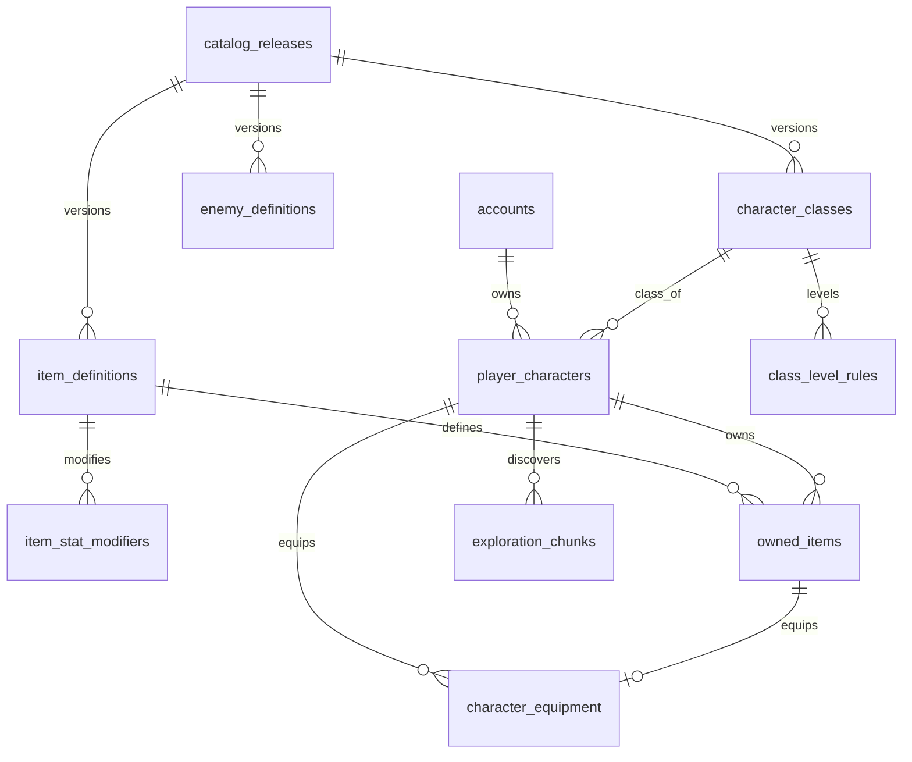

# RPG data model proposal

**Design only; final 09A.2 review.** Four tables are proposed for the first catalog implementation; seven are reserved for later milestones. The SQL companion contains the same 11 proposed tables and is **NOT APPROVED FOR EXECUTION**. Published catalog rows are immutable; runtime spawn state is not a database row.

## Relationships

The first playable adventure creates three **runtime** Guardian instances from one `enemy_definitions` row plus scene-specific overrides. None needs a persistent row. A future unique boss/quest spawn can get persistent instance state when its gameplay requires it. Friendly NPC definitions may later use a separate table if dialogue/merchant behavior differs materially; no speculative NPC table is included now.

## Immediate catalog tables (09A.2)

| Table | Why it exists | Key constraints and lifecycle |
| --- | --- | --- |
| `catalog_releases` | Names a complete, immutable catalog snapshot, schema major, hash and publication state | UUID PK, unique version key, at most one `published` release; draft hash may be NULL, published/retired hash and timestamp are required; old releases retained while referenced |
| `character_classes` | Dwarf Warrior and later playable class base values and local visual key | UUID PK; release FK; unique `(release, code)`; health, fixed damage, attributes, armor, movement, range and attack timing checks |
| `enemy_definitions` | Fallen Guardian base stats, attack/AI tuning and local visual key | UUID PK; release FK; unique `(release, code)`; no per-spawn rows; first-adventure overrides stay explicit |
| `item_definitions` | Shared versioned catalog for weapons, armor, consumables and quest items | UUID PK; release FK; unique `(release, code)`; category, rarity, stack and equipment slot checks; `hand_requirement=1/2` for weapons only; no damage or speed effect in 09A |

`hand_requirement` is a small integer restricted to 1 or 2 on weapons and NULL on other items. A two-handed weapon occupies the main-hand slot **logically** and requires the off-hand slot to remain empty. The catalog CHECK rejects two-handed weapons authored for `off_hand`. When equipment exists, the backend must validate both slots together in one transaction (including attempts to equip an off-hand item while a two-handed weapon is equipped). The current `character_equipment` table alone cannot enforce this cross-row, cross-table rule with a simple CHECK; a later equipment milestone must add transaction tests and decide whether an additional database trigger is needed. No inventory or equipment behavior is activated here.

The initial `fixed_damage` values are the **complete current attack result** (Dwarf 25, Guardian 10), independent of the visual axe/sword catalog entries. The training axe and Guardian sword have no active damage, speed or stat bonus. In 09B, define a new versioned formula before assigning weapon statistics: class/enemy base attack profile, weapon damage range, additive/percentage modifiers, attack-cycle modifier, armor and critical rules with explicit rounding. A weapon's intrinsic minimum/maximum damage would be stored once on the weapon definition (after a separate schema migration); generic equipment bonuses remain in `item_stat_modifiers`. `attack_speed` there is a modifier to the authored cycle, not a second independently writable cycle. The 09A schema deliberately omits speculative weapon damage and speed columns because their values, units and precedence are not approved. A future catalog version must state whether weapon damage replaces or augments the legacy fixed result; it must never silently add a newly seeded value to today's 25 damage.

The database design enforces release lifecycle and ordinary-DML immutability with a partial unique index, row checks, and proposed triggers on the four initial tables. Definition triggers lock the parent release row and accept edits only while it is `draft`, serializing with publication. A release begins as draft, can transition to published with a complete hash/timestamp, and can only transition from published to retired without changing its content metadata. Retired releases are retained, not deleted. This prevents a publisher with permitted DML from silently changing published rows; a database owner or superuser with DDL authority could still replace the guards, so schema privileges remain restricted. The API validates completeness, canonical hash, references and version compatibility before publication; database checks cannot prove the content hash matches rows. [PostgreSQL trigger behavior](https://www.postgresql.org/docs/18/trigger-definition.html) and [partial unique indexes](https://www.postgresql.org/docs/18/sql-createindex.html) support these distinct guarantees.

## Deferred persistent/progression tables

| Table | When needed | Constraints and ownership |
| --- | --- | --- |
| `accounts` | Authenticated identity milestone | UUID PK; unique `(identity_provider, provider_subject)`; no password or auth bypass design in this schema |
| `player_characters` | Character creation/persistence | UUID PK; account FK, pinned class-definition FK, name, experience, allocated attributes, revision, soft deletion; `level` is derived from version-pinned progression rules instead of a second writable truth |
| `class_level_rules` | XP/level progression | `(class_id, level)` PK and unique total XP values; level 1 starts at 0; publication validation must require contiguous levels and strictly increasing thresholds by level, because uniqueness alone does not establish order |
| `item_stat_modifiers` | Equipment balancing | `(item_definition_id, stat_code, modifier_kind)` PK; typed, validated stat codes/amounts instead of arbitrary JSON or an entity-attribute-value system |
| `owned_items` | Inventory | UUID PK, character and immutable item-definition FKs, positive quantity, revision; ownership lives here, not in item definitions |
| `character_equipment` | Equipped inventory | `(character_id, slot_code)` PK; unique owned item; composite FK ensures the item belongs to the same character; API validates category and slot compatibility |
| `exploration_chunks` | Persistent Fog of War | Composite key by character, map revision, region and chunk coordinates; compact `bytea` discovered mask, dimensions/encoding/revision; current visibility is never persisted |

For future exploration writes, the authenticated owner/host must validate region and map revision against an approved map manifest, bounded grid dimensions and cell size, coordinate range, encoding, and exact raw bit count (`ceil(width * height / 8)`). Compressed payloads need a maximum encoded size, decompression limit and decoded bit-count check to prevent expansion attacks. Merge only discovered bits, never transient current visibility; use `row_revision` or a serialized transaction for concurrent updates. Map revisions must not be silently reinterpreted. None of this is implemented now.

## Stat rules and derivation

The immediate catalog stores integer maximum health and **fixed** damage, preserving today's exact 100/25/10 behavior. Strength, dexterity, vitality and armor columns remain nullable and **inactive** in 09A.2–09A.5; no unverified zero values are seeded. `class_level_rules` later adds level bonuses, `player_characters` stores allocated points, and `item_stat_modifiers` adds equipment modifiers. A future server-side `CombatStatCalculator` can compute an immutable effective stat snapshot at encounter start in a documented order: class/enemy base → level/allocations → equipment → temporary buffs → clamping/rounding. Buffs are transient runtime effects until persistence is actually required.

Minimum/maximum damage, critical chance, critical multiplier and attack-speed modifiers are **future computed outputs**, not redundant columns beside today's fixed damage. When 09B defines a formula, item modifiers and optional authored profiles can contribute to those outputs. Nothing in this schema silently enables randomized hits or criticals. Health's *current* value is a runtime `HealthComponent` field during play; persistence of live encounter HP is not proposed yet. Attack timings and ranges are catalog configuration, not derived from animation duration. Store fixed whole milliseconds and millimetre-precision metres in PostgreSQL; convert once to Godot floats when constructing the pinned runtime snapshot. PostgreSQL `numeric` is exact for authored decimal distances/rates; runtime Godot physics remains float-based. [PostgreSQL numeric types](https://www.postgresql.org/docs/current/datatype-numeric.html) document this distinction.

`attack_speed` later means an effective attack-cycle rate derived from the authored cycle and modifiers; it should not compete with a separately writable cycle duration. `defense/armor` is a future mitigation input, not active damage reduction. This avoids storing both a result and multiple inconsistent sources for it.

## Modeling choices

- **UUIDs:** persistent identity and definition references use UUID. A short `code` is the human-readable stable catalog key. UUIDs cost more index space than integers but avoid cross-system ID allocation; the catalog is tiny. The API supplies UUIDs, so the proposal does not depend on a particular PostgreSQL UUID generator.
- **Lookup codes versus PostgreSQL enums:** `text` plus `CHECK` for the initial small stable sets (`category`, `rarity`, `slot`, `status`) keeps migrations straightforward. Move to lookup tables only when designers need user-managed or localized values. PostgreSQL enums are less convenient when an evolving game adds or retires values.
- **JSONB:** no core relationships/stats use JSONB. Relational columns and FKs protect ownership and balancing. A bounded, validated JSONB payload may be justified later for genuinely variable, non-queryable item flavor data; it is absent now. [PostgreSQL JSONB documentation](https://www.postgresql.org/docs/current/datatype-json.html) describes its indexing and representation tradeoffs.
- **Deletion:** catalog releases/definitions are retained (`RESTRICT`) while referenced. Account deletion is an explicit future privacy workflow; characters are soft-deleted for gameplay, with controlled purge cascading inventory/exploration. Owned-item deletion releases an equipment slot. `updated_at` and revision columns on mutable rows are set/incremented by the backend within each write transaction.
- **One-character limit:** `accounts 1:N player_characters` remains relationally valid. `MaxCharactersPerAccount=1` is an API business rule. The create transaction locks the account row (`SELECT ... FOR UPDATE`), counts non-deleted characters, then inserts before commit. All writers use this path and DB roles deny direct client writes. A unique one-character DB constraint would prevent raising the limit later. [PostgreSQL row-lock rules](https://www.postgresql.org/docs/current/explicit-locking.html) support this serialization pattern.
- **Fog of War:** persist only the discovered bitset per character/map revision/chunk. Current visibility is recalculated from position and obstacle line of sight; unseen enemies are hidden by presentation, not destroyed or removed from AI. Atmospheric fog is an unrelated rendering effect. The previously approved [visibility design](../FOG_OF_WAR_DESIGN.md) remains future scope.
